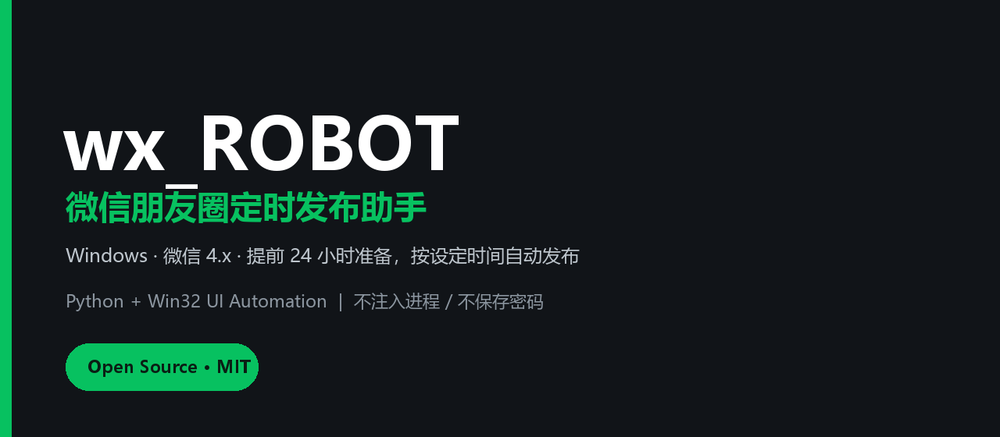

# wx_ROBOT

<div align="center">



**微信朋友圈定时发布助手 · Windows · 微信 4.x**

提前准备文案和图片，在接下来的 24 小时内按设定时间自动发布。

[](https://www.python.org/)
[]()
[]()
[](LICENSE)

</div>

---

> **请先阅读**：本项目通过 Windows 鼠标/键盘模拟操作**已登录的微信 PC 客户端**，不注入微信进程、不修改微信数据库、不保存密码。请仅用于自己的账号，并遵守微信使用规范。微信客户端版本更新后，界面布局可能变化，自动化坐标可能需要调整。

## 目录

- [它能做什么](#它能做什么)
- [工作流程](#工作流程)
- [环境要求](#环境要求)
- [快速开始](#快速开始)
- [准备一条朋友圈](#准备一条朋友圈)
- [使用说明](#使用说明)
- [配置项](#配置项)
- [项目结构](#项目结构)
- [实现原理](#实现原理)
- [常见问题](#常见问题)
- [安全边界](#安全边界)
- [License](#license)

## 下载与安装

### 方式一：下载即用包（推荐，内置 Python）

前往 [Releases](https://github.com/BakaZ1DU/Project-MAMAMIYA/releases/latest) 下载：

```text
wx_ROBOT-v1.0.2-win64.zip
```

- 约 25MB，内含便携 Python 运行时；
- 解压后双击 `启动.bat` 即可，不需要另外安装 Python；
- 第一次使用建议先点“预览填充（不发布）”检查。

> 不要在压缩包里直接运行，先完整解压到一个普通文件夹。

### 方式二：源码运行

需要 Python 3.12 + Pillow：

```bash
git clone https://github.com/BakaZ1DU/Project-MAMAMIYA.git
cd Project-MAMAMIYA
python -m pip install -r requirements.txt
copy config.example.json config.json
```

然后双击 `启动.bat`。

## 它能做什么

- **提前 24 小时准备**：文案、图片先存进本地队列，到点自动发。
- **按设定时间发布**：支持未来 24 小时内的任意分钟级时间。
- **图文朋友圈**：1–9 张 jpg / png / bmp 图片 + 最多 1500 字文案。
- **可见范围**：默认 `keep`，保持微信当前设置，不自动点“谁可以看”（最稳）；需要时可设 `public` / `private`。
- **失败可见**：自动识别微信的“照片未发送”提示，失败不会假装成功。
- **失败归档**：连续失败/不可重试的错误会移到 `失败/`，不会无限重试刷屏。
- **本地优先**：队列、日志、截图都在本地；不依赖云端服务。

## 工作流程

```text
你提前准备
   │
   ▼
待发布/20261030_0830_晚霞/
   文案.txt
   图片/01.jpg ...
   │
   ▼ 每 3 秒扫描
到点 → 聚焦微信 → 打开朋友圈 → 相机 → 选择图片
   → 填入文案 → 保持/设置可见范围 → 点“发表”
   → 检查是否出现“照片未发送”
   → 成功：移动到 已发布/
   → 失败：截图 + 记录原因 + 按策略重试/归档
```

## 环境要求

| 项目 | 要求 |
|---|---|
| 系统 | Windows 10 / 11（x64） |
| 微信 | Windows 微信 4.x（开发验证版本 4.1.13.65） |
| Python | 3.12（3.10+ 理论可用，未逐一验证） |
| 依赖 | `Pillow`（tkinter 为 Python 自带） |
| 屏幕 | 建议 100% / 125% 缩放；程序会做 DPI 感知 |
| 状态 | 微信已登录、能正常打开朋友圈、电脑不锁屏 |

> 微信 3.x 的界面结构不同，不保证可用。

## 首次运行

- **下载即用包**：解压后已经自带 `config.json`，直接双击 `启动.bat`。
- **源码运行**：先执行 `copy config.example.json config.json`。

可选配置（`config.json`）：

- `account_wxid`：只用于界面提示，留空即可；
- `wechat_exe`：留空会自动在常见路径/注册表里找微信；
- `privacy`：默认 `keep`（保持微信当前设置）；可选 `public` / `private`，但自动点选有误触风险，建议保持 `keep`。

`启动.bat` 会按以下顺序找 Python：

1. 程序目录下的 `runtime\pythonw.exe`（下载即用包自带）；
2. `%LOCALAPPDATA%\Programs\Python\Python312\pythonw.exe`；
3. PATH 里的 `pyw -3.12`；
4. PATH 里的 `pythonw`。

启动后保持窗口运行即可。发布时程序会短暂抢占鼠标键盘，请不要操作。

## 准备一条朋友圈

在软件里点 **“新建”**：

1. **发布时间**：格式 `2026-10-30 08:30`，只能选未来 24 小时内；
2. **文案**：最多 1500 字；
3. **图片**：1–9 张，按列表顺序发布，可上移/下移；
4. 点 **“保存计划”**。

保存后会生成：

```text
待发布/20261030_0830_晚霞/
  文案.txt
  图片/01_xxx.jpg
  图片/02_xxx.jpg
  post.json
```

你可以直接编辑 `文案.txt`，或替换 `图片/` 里的文件；程序发布时会重新读取。

## 使用说明

### 三种按钮

| 按钮 | 作用 |
|---|---|
| **保存计划** | 写入队列，等待到点自动发布 |
| **预览填充（不发布）** | 真实打开微信编辑框并填入内容，但**不点发表**，适合第一次检查 |
| **立即发布** | 立即真实发布，会二次确认 |

### 状态

| 状态 | 含义 |
|---|---|
| 草稿 | 不参与自动发布 |
| 待发布 | 到点自动发 |
| 发布中 | 正在操作微信 |
| 已发布 | 已归档到 `已发布/年-月/` |
| 失败 | 重试次数用完或不可重试，归档到 `失败/` |
| 已跳过 | 错过时间超过补发窗口（默认 90 分钟） |

### 发布时会发生什么

1. 程序把微信窗口还原为普通大小（最大化时右上角按钮可能点不动）；
2. 找到主窗口，进入“朋友圈”；
3. 点相机 → 在文件对话框里进入这条计划的 `图片/` 文件夹 → 全选；
4. 在编辑框里清空旧草稿，粘贴文案，再回读校验；
5. 选择“公开/私密”；
6. 点绿色“发表”；
7. 等待编辑框关闭，并观察朋友圈右侧是否出现“照片未发送”提示；
8. 确认成功才归档。

## 配置项

`config.json`：

| 键 | 默认 | 说明 |
|---|---|---|
| `account_wxid` | `""` | 仅界面提示，可留空 |
| `max_schedule_hours` | `24` | 最多提前多少小时 |
| `catch_up_minutes` | `90` | 错过时间后多少分钟内补发 |
| `check_interval_seconds` | `3` | 队列扫描间隔 |
| `max_retries` | `2` | 可重试错误的最大重试次数 |
| `retry_delay_minutes` | `8` | 重试间隔 |
| `max_images` | `9` | 最多图片数 |
| `max_text_chars` | `1500` | 最多文案字数 |
| `keep_awake` | `true` | 发布期间阻止睡眠/熄屏 |
| `wechat_exe` | `""` | 微信路径；留空自动探测 |
| `start_wechat_if_needed` | `true` | 微信没开时尝试启动 |
| `verify_text` | `true` | 粘贴后回读校验文案 |
| `image_settle_seconds` | `4` | 选图后等待图片处理的时间 |
| `publish_wait_seconds` | `35` | 点发表后等待编辑框关闭的上限 |
| `failure_check_seconds` | `15` | 发表后观察“照片未发送”的时长 |
| `privacy` | `keep` | `keep` 保持微信当前设置；`public` / `private` 自动点选（有误触风险） |

## 项目结构

```text
Project-MAMAMIYA/
├─ app.py                 # Tkinter 界面 + 调度器
├─ wechat_ui.py           # Win32 微信朋友圈 UI 自动化
├─ store.py               # 队列、配置、归档
├─ config.example.json    # 配置模板
├─ requirements.txt
├─ 启动.bat
├─ 诊断启动.bat
├─ 安装依赖.bat
├─ wx_robot.ico
├─ assets/                # 相机/朋友圈/发现图标模板
│  ├─ camera.png
│  ├─ moments_icon.png
│  └─ discover_green.png
├─ docs/
│  ├─ banner.png
│  ├─ 使用说明.md
│  ├─ FAQ.md
│  └─ architecture.md
├─ 待发布/                # 运行时创建
├─ 已发布/
├─ 失败/
├─ 已删除/
└─ logs/
```

## 实现原理

- **窗口定位**：`EnumWindows` + 进程路径过滤，找到微信主窗口。
- **页面判断**：截图右上角深色相机栏，判断“朋友圈”是否加载完成。
- **图片选择**：`Ctrl+L` 进入计划自己的图片文件夹，再 `Ctrl+A` 全选，避免复用上一次的选择。
- **文案校验**：粘贴后 `Ctrl+A/C` 回读剪贴板，确认文字真的进了编辑框。
- **发表按钮**：在编辑框下半部扫描微信绿 `#07C160`，找横向绿色按钮，不依赖固定坐标。
- **失败识别**：发表后观察朋友圈右侧是否新增“照片未发送”提示条；只扫描提示条区域，避免把封面/图片误判。
- **清理**：失败时按 `Esc` → “取消” → “不保留” 清理编辑框，不点发表。

更多细节见 [docs/architecture.md](docs/architecture.md)。

## 常见问题

### 1. 日志说失败，但朋友圈其实发出去了？

已在 v1.0.1 修复“照片未发送”误报：检测区域收窄到真实提示条，成功帖不会再被封面/图片的深色+红色像素误判。

如果仍遇到，请把 `logs/previews/` 下对应截图和 `logs/wxrobot.log` 一起反馈。

### 2. 微信提示“照片未发送”

先手动在微信里发一张图片：

- 手动也失败：是微信/账号/网络/图片上传通道的问题，不是本程序；
- 手动正常、只有程序失败：检查 `logs/previews/photo_not_sent_*.png` 和日志。

详细排查见 [docs/FAQ.md](docs/FAQ.md)。

### 3. 相机按钮点不开

程序会先把最大化窗口还原成普通窗口；如果仍失败，可能是：

- 朋友圈页面没加载完；
- 微信窗口被其他窗口遮挡；
- 微信版本 UI 变化。

用 `诊断启动.bat` 启动，查看控制台和 `logs/previews/no_file_dialog_*.png`。

### 4. 电脑锁屏/睡眠

锁屏时无法操作 UI；程序会跳过并等待解锁。默认会阻止系统睡眠，但不能阻止手动合盖/锁屏。

### 5. 可以发视频/链接/位置/@好友吗？

目前只支持 **图片 + 文案**。视频、链接、位置、提醒谁看等未实现。

## 安全边界

- 不破解微信、不注入进程、不读取聊天记录/数据库；
- 不保存账号密码；
- 不绕过登录、风控、验证码；
- 遇到“照片未发送”、安全验证、账号限制会停止并记录，不会硬点；
- 请只操作自己的账号，并遵守微信的使用规范；
- 本项目按 MIT 协议开源，使用风险自负。

## License

[MIT](LICENSE) © 2026 Baka_Z1DU
